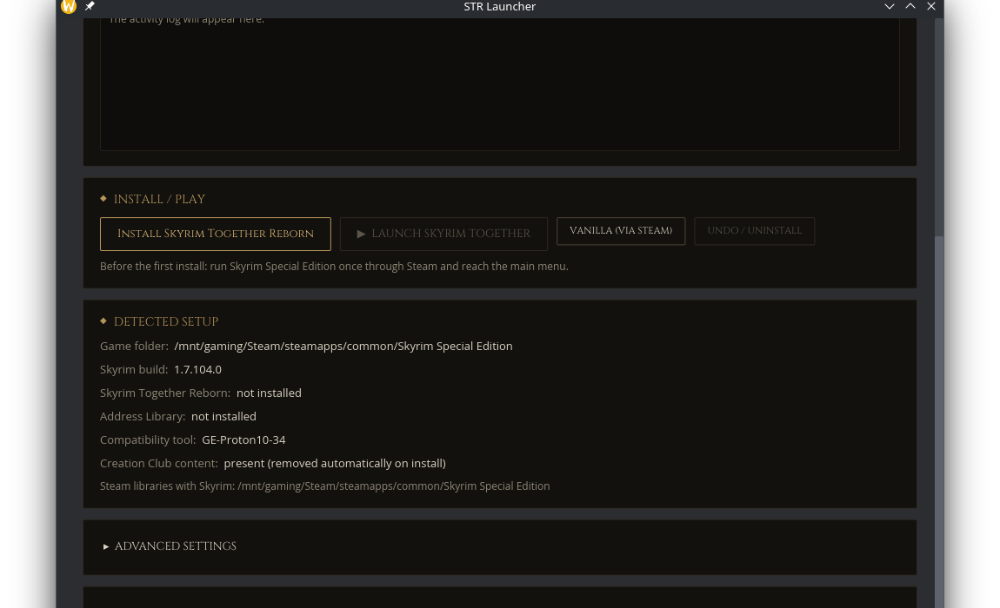

# STR Launcher

**Play Skyrim Together Reborn with your friends — on Windows or Linux — in one
click.** No Vortex, no MO2, no manual file shuffling: STR Launcher finds your
Skyrim, installs the mod, and gets you into a multiplayer session.



## What you need

- **Skyrim Special Edition (Steam, v1.6 or newer)** — launch it once through
  Steam first (reach the main menu, then quit). The Anniversary Upgrade DLC is
  *not* needed, and is best disabled.
- A free [Nexus Mods](https://www.nexusmods.com) account.
- Windows 8.1+ or Linux (Steam Deck works great).

## Quick start

1. **Download STR Launcher** from the
   [releases page](https://github.com/CyrixJD115/Skyrim-TR/releases) and run it.
   It finds your Skyrim install automatically.
2. **Paste your Nexus API key** (Settings → Nexus Mods) so it can download the
   mods for you: get it from your
   [Nexus account settings](https://www.nexusmods.com/users/account?tab=api)
   → *Generate personal key*. One time only, stored on your PC.
3. Press **Install Skyrim Together Reborn** and wait for the readiness
   checklist to go green — it checks everything (game version, Address
   Library, plugins, Proton) so nothing fails silently.
4. Press **Launch Together**. In-game, press **F2** to open the multiplayer
   menu, create a party, and invite your friends.

> ⚠️ Finish the Helgen intro *before* connecting to a server — see the
> official [play guide](https://wiki.tiltedphoques.com/tilted-online/general-information/playguide)
> (one minute, well worth it).

### No API key? Offline mode

Download the two archives manually —
[Skyrim Together Reborn](https://www.nexusmods.com/skyrimspecialedition/mods/69993?tab=files)
and
[Address Library](https://www.nexusmods.com/skyrimspecialedition/mods/32444?tab=files) —
drop them in under Settings → Offline mode, and press Install. No key needed.

### Playing with friends

- **Same network / internet:** one of you hosts. Open the **Server** tab, download
  the dedicated server, press start, and friends connect with your IP
  (Settings let you set the port, name and password).
- Keep it simple: create **one party** per playthrough and let one person lead
  the quests — the game syncs quests through the party.

## Good to know

- **Nothing is deleted without a backup.** Removed Creation Club content goes
  to `str-cc-backup/`, and a manifest in the game folder records every file the
  launcher touched — **Undo** restores your Skyrim to exactly how it was
  (including the registry keys and Steam library entry on Windows).
- **GOG / Epic / Heroic?** On Windows the launcher also finds Skyrim in GOG
  Galaxy, the Epic Games Launcher, Heroic and common manual install locations;
  the Steam library entry works there too. Steam detection and the Steam launch
  integrations remain Steam-only (the mod itself is built for Steam), but the
  installer still works: point it at your `SkyrimSE.exe` under Settings →
  Game → Browse.
- **Linux:** the launcher pins **GE-Proton 10** automatically (GE-Proton 11+
  crashes Skyrim Together 1.8 — selecting one shows a hard warning) and offers
  two launch modes — replace the Skyrim launcher, or add a separate
  *"Skyrim Together Reborn"* entry to your Steam library with its own artwork.
  Both are fully reversible with Undo. While Steam is running, changing the
  compatibility tool waits for your explicit **Restart Steam** click instead of
  force-restarting, and Flatpak Steam installs are handled too.
- **Server hosting:** the Server tab shows every LAN address with the
  configured port (one-click copy), validates `STServer.ini` fields, and ships
  copy-paste firewall commands (Windows Firewall / ufw / firewalld). The
  server downloads from Nexus first and falls back to the official
  TiltedPhoques GitHub release without an API key.
- **A diagnostics log** is written to the launcher's config folder
  (`launcher.log`, rotated) and records every activity-pane line plus any
  crash — attach it when reporting problems. The launcher also checks
  [releases](https://github.com/CyrixJD115/Skyrim-Together-Reborn-Launcher/releases)
  at startup and shows a banner when a newer version exists; it never updates
  itself.
- **File integrity:** installed STR files are verified against a
  signed-off manifest of known-good hashes (`version-manifest.json`); the
  readiness checklist flags mismatches.

## Command line (headless)

The same pipelines run without the GUI — handy for scripts and CI:

```bash
str-launcher --headless install --game-dir "/path/Skyrim Special Edition"   --offline-str str.zip --offline-al addresslibrary.zip
str-launcher --headless launch
str-launcher --headless server --offline-server server.zip
str-launcher --headless --help   # all options
```

Exit codes: 0 success, 1 pipeline failure, 2 bad usage. (On Windows the app is
a GUI binary — run headless mode from a terminal.)

## Troubleshooting

- **"Not purely vanilla" warning** — Run Install again with the current launcher.
  It repairs the active Proton profile’s plugin list and required load order.
  Keep Creation Club cleanup enabled. The readiness checklist reports remaining
  extra or inactive plugins; disable additional mods separately. Steam updates
  or file verification can restore Creation Club files, requiring cleanup again.
- **"Skyrim Together is not running!"** — Press **Undo**, then **Install** again.
- **Crash on connect** — All players must run the same STR version (use
  *Check updates*). The launcher already removes bundled Creation Club content;
  don't add other mods — they're the #1 cause of crashes with Skyrim Together.
- **Steam Deck black screen** — Remove any old custom launch options for
  Skyrim in Steam (this launcher doesn't need them).
- **Wrong Proton in use** — Steam → Skyrim → Properties → Compatibility → pick
  *GE-Proton 10*. The launcher normally sets this for you.

The activity pane in the launcher logs every step; Downloads are reachable via
Settings → Open downloads.

---

## Building from source

Requires Rust 1.77+ (stable).

```bash
# Linux (needs wayland/x11 dev bits; on Arch:
#   pacman -S base-devel wayland libxkbcommon libx11)
cargo build --release

# Windows (MSVC environment)
cargo build --release
```

The binary is self-contained — no installer, no runtime dependencies.
Every push to `main` is built by CI for
[Windows and Linux](.github/workflows/ci.yml); binaries land in the run's
artifacts.

## Credits

- [Tilted Phoques](https://github.com/tiltedphoques) — Skyrim Together Reborn,
  and the dragon emblem used in this launcher's icon and menu
  ([TiltedEvolution skyrim_ui assets](https://github.com/tiltedphoques/TiltedEvolution))
- [Cinzel](https://fonts.google.com/specimen/Cinzel) (SIL Open Font License) —
  the carved-caps Skyrim-style heading font bundled with the launcher
- [Cyphs](https://github.com/Cyphs/SteamDeckSTR) (based on
  [pikdum](https://github.com/pikdum/steam-deck)'s scripts) — the Linux approach
  (launcher replacement, protonfixes localfix, config.vdf handling) is ported
  from and inspired by their MIT-licensed work
- [GloriousEggroll](https://github.com/GloriousEggroll/proton-ge-custom) — GE-Proton

## License

MIT — see [LICENSE](LICENSE).
